# ha-tracker-card

[](https://www.home-assistant.io/integrations/marketplace/)
[](https://github.com/juju35/ha-tracker-card/actions/workflows/hacs.yml)
[](https://github.com/juju35/ha-tracker-card/actions/workflows/validate.yml)
[](https://github.com/juju35/ha-tracker-card/actions/workflows/lint.yml)
[](https://github.com/juju35/ha-tracker-card/releases/latest)
[](https://github.com/juju35/ha-tracker-card/blob/main/LICENSE)
[](https://buymeacoffee.com/julienstep9)

<p align="center">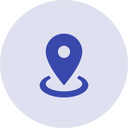</p>

<p align="center">
  &nbsp;&nbsp;
  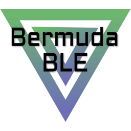&nbsp;&nbsp;
  &nbsp;&nbsp;
  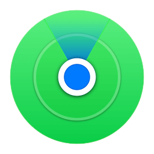&nbsp;&nbsp;
  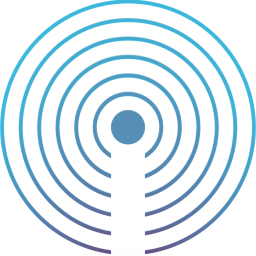&nbsp;&nbsp;
  &nbsp;&nbsp;
  &nbsp;&nbsp;
  
</p>

Lovelace cards for Home Assistant for **the things you track**: keys, bags, wallets, bikes, suitcases and pets with Bluetooth or GPS tags (Tile, Bermuda, Google Find My Device, Apple Find My, SmartThings Find, Tractive, PAJ GPS, Traccar…) on a **radar around home**, with where each one is (home and its **room**, a zone, away), when it was **last seen**, its **battery**, its **distance** and a button to **ring** it.

The device trackers of tag, collar and GPS tracker integrations are found through the entity registry, and each one's battery, Bermuda area, last-seen time and ring button through its device: nothing to configure. Phones and people (Mobile App, routers, iCloud devices, and the phones, tablets and computers that Google Find My Device and SmartThings Find also list) are left out; list any tracker in `trackers` to show it anyway.

[](https://my.home-assistant.io/redirect/marketplace_repository/?owner=juju35&repository=ha-tracker-card&category=plugin)

| Tracker Card | Tracker Mini Card |
|---|---|
| 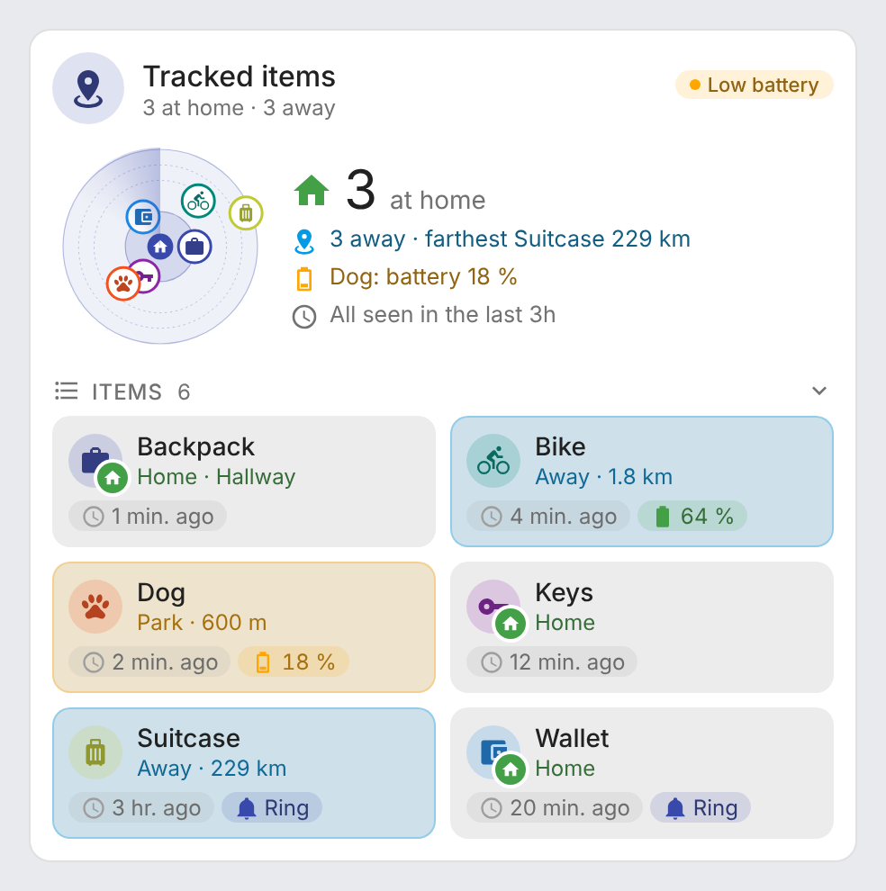 | 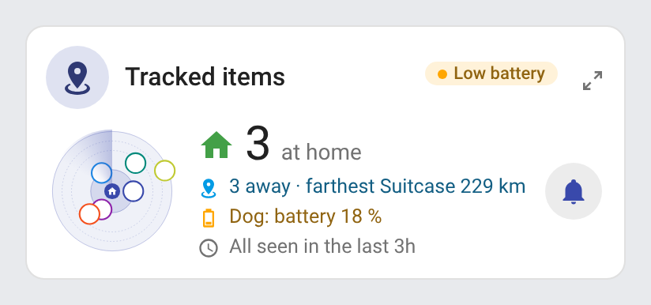<br>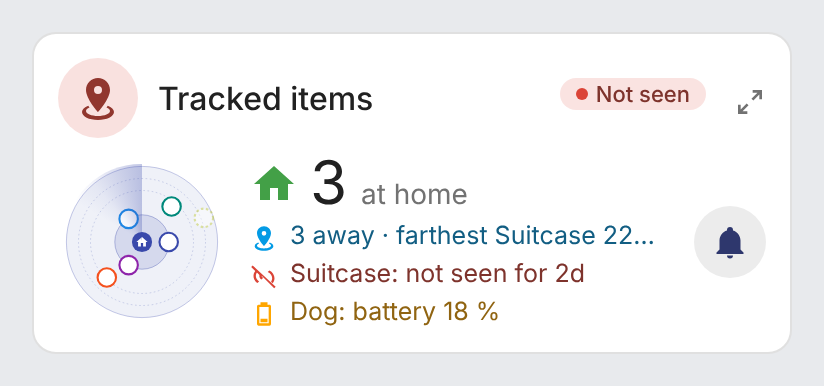 |

## Features

- Two cards: a full **Tracker Card** (`custom:tracker-card`) and a compact **Tracker Mini Card** (`custom:tracker-mini-card`)
- A **radar** next to how many items are home, with home in the middle and each item at its direction and distance, on a log scale (the dog in the park and the suitcase 200 km away on the same radar); the items at home round the house; a beam sweeps it (see [Animations](#animations))
- Lines next to the radar: how many items are away and the farthest one, the items not seen or with a low battery, when they were all last seen
- Each item as a **tile**, as on the other cards: grey at home, tinted blue when away, amber with a low battery, red when not seen; its **place** (home and the **room** Bermuda sees it in, a zone such as *Park*, away) and **distance** from home; pills with when it was **last seen** and its **battery**
- **Ring** an item with its device's button (play sound, ring, locate): the bell of its *Ring* pill shakes for a moment
- **Illustrated header** (90 px, full and mini card): a street map with home in the middle of a radar whose beam sweeps, a **pin per item** in its own colour (round home, or at its direction and distance when away, with a dashed route to the farthest one), over a 10 px map strip; day and night pictures (`illustration_theme`, by default following the Home Assistant theme: night with a dark theme, day with a light theme)
- The header follows the state: **all home** in green, items **away** in blue (their pins bob), a **low battery** in amber (a battery blinks by the pin, the item and its level in the subtitle), an item **not seen** in red (its pin fades and pulses, the subtitle says since when); the round icon takes the same colour
- An item **not seen** for a day (`lost_after`) in red and dimmed on the radar; `illustration: false` brings back the classic header with a *Not seen* or *Low battery* chip
- Kilometres and metres, or miles and feet when Home Assistant uses them
- Collapsible items section, folded back to its default by a click elsewhere on the page
- Detail button on the mini card (top right): it switches the mini card to the full card's content and back; a click anywhere outside the card brings the compact view back
- Visual editor in the dashboard UI for both cards (no YAML needed)
- Light and dark mode, English, French, German, Spanish, Serbian (Cyrillic and Latin), Italian, Dutch, European Portuguese, Polish, Romanian, Danish, Swedish, Bulgarian, Russian, Ukrainian, Hungarian, Slovak, Czech, Slovenian, Latvian and Greek
- Single file, no external dependency

## Supported integrations

| Integration | What the cards use |
|---|---|
|  [Tile](https://www.home-assistant.io/integrations/tile/) (core) | Tile trackers: position, last seen |
|  [Bermuda BLE Trilateration](https://github.com/agittins/bermuda) (custom) | Bluetooth tags, beacons and devices: home or away, and the **area** they are in (its area sensor, else the tracker's `area` attribute) |
|  [Private BLE Device](https://www.home-assistant.io/integrations/private_ble_device/) (core) | Apple devices and tags with a rotating address: home or away, **estimated distance** |
|  [iBeacon Tracker](https://www.home-assistant.io/integrations/ibeacon/) (core) | iBeacons: home or away, **estimated distance** |
|  [Google Find My Device](https://github.com/BSkando/GoogleFindMy-HA) (custom) | Find My Device tags (phones only when listed in `trackers`): position, last seen, **play sound** button (locate when there is none) |
|  [SmartThings Find](https://github.com/Vedeneb/HA-SmartThings-Find) (custom) | Galaxy SmartTags: position, battery, **ring** button |
|  [Apple Find My](https://github.com/malmeloo/hass-FindMy) (custom) | AirTags and Find My accessories: position, last seen, **play sound** button |
|  [Apple iCloud](https://www.home-assistant.io/integrations/icloud/) (core) | iCloud devices (iPhone, iPad, Mac), only when listed in `trackers`: position, battery |
|  [Tractive](https://www.home-assistant.io/integrations/tractive/) (core) | Pet collars: position, zone, battery, **buzzer** to ring the collar |
| [Fressnapf Tracker](https://www.home-assistant.io/integrations/fressnapf_tracker/) (core) | Pet collars: position, battery |
|  [PAJ GPS](https://www.home-assistant.io/integrations/paj_gps/) (core) | GPS trackers (bikes, cars, luggage): position, battery |
|  [Traccar Server](https://www.home-assistant.io/integrations/traccar_server/) (core) | GPS trackers of a Traccar server: position, battery |
| Any other `device_tracker` | Listed in `trackers`: its place, position and the battery, area and ring button of its device |

The cards read `device_tracker` entities (their state, `latitude` and `longitude`), the `zone.home` zone, and the battery sensors, Bermuda area sensors, last-seen sensors and ring buttons (`button.press`) of the trackers' devices.

## Prerequisites

Home Assistant 2024.8 or later, with at least one tag, collar or GPS tracker integration (or device trackers listed in `trackers`).

## Installation

### Via the Marketplace (recommended)

Click the button below to add the repository directly:

[](https://my.home-assistant.io/redirect/marketplace_repository/?owner=juju35&repository=ha-tracker-card&category=plugin)

Then click **Install**, and reload your browser when the Marketplace asks you to.

Or manually:

1. Open **Settings → Marketplace → Add from link** (top right; this needs a GitHub account connected)
2. Add `https://github.com/juju35/ha-tracker-card` — Type: **Dashboard**
3. Open **Tracker Card** and click **Install**
4. Clear your browser cache and refresh

The Marketplace adds the resource `/local/community/ha-tracker-card/tracker-card.js` for you.

### Manual

1. Download `tracker-card.js` and the `tracker-card.i18n.*.js` translation files from the [latest release](https://github.com/juju35/ha-tracker-card/releases/latest)
2. Copy them all to `/config/www/` (without the translation files, the cards show in English)
3. Go to **Settings → Dashboards → ⋮ → Resources** → Add resource:
   - URL: `/local/tracker-card.js`
   - Type: **JavaScript Module**
4. Clear your browser cache and refresh

## Configuration

### Card types

| Card | Type |
|---|---|
| Tracker Card | `custom:tracker-card` |
| Tracker Mini Card | `custom:tracker-mini-card` |

### Visual editor

Edit a dashboard, click **Add card** and search for **Tracker Card** or **Tracker Mini Card**. Every tracker found is shown when the list of trackers is left empty; pick the trackers, the low battery level, the delay after which an item counts as not seen, the radar's range, the sections and the language. The preview updates live, and options left at their default are kept out of the generated YAML.

### Minimal

```yaml
type: custom:tracker-card
```

```yaml
type: custom:tracker-mini-card
```

### Full options

```yaml
type: custom:tracker-card
title: Tracked items
trackers:
  - device_tracker.keys
  - entity: device_tracker.airtag_1
    name: Suitcase
    icon: mdi:bag-suitcase
    button: button.airtag_1_play_sound
battery_threshold: 20
lost_after: 24
radar_range: 50
illustration: true
illustration_theme: auto
show_title: true
show_subtitle: true
show_radar: true
show_items: true
show_distance: true
show_battery: true
show_seen: true
collapsed: []
language: en
```

```yaml
type: custom:tracker-mini-card
mini_count: 3
zoom: true
```

### Options reference

| Option | Card | Default | Description |
|---|---|---|---|
| `title` | both | Tracked items | Card title |
| `illustration` | both | `true` | The illustrated header (map, radar and pins); `false`: the classic header with a status chip |
| `illustration_theme` | both | `auto` | The header's picture: `auto` (follows the Home Assistant theme: night with a dark theme, day with a light theme), `day` or `night` |
| `show_title` | both | `true` | Show the title in the header |
| `show_subtitle` | both | `true` | Show the subtitle (how many items are home and away, or the item that needs a look) |
| `trackers` | both | Every tracker found | Device trackers: entity ids, or objects with `entity`, `name`, `icon`, `color`, `battery`, `area` and `button` (objects: YAML only, the visual editor then hides the field) |
| `battery_threshold` | both | `20` | Battery level (%) at or below which a battery is low |
| `lost_after` | both | `24` | Hours without news after which an item counts as not seen (`0`: never) |
| `radar_range` | both | Automatic | Distance (km) at the radar's edge; by default the first round distance past the farthest item |
| `show_radar` | both | `true` | The radar (the lines stay) |
| `show_items` | both | `true` | The item tiles |
| `show_distance` | both | `true` | Distances from home |
| `show_battery` | both | `true` | Batteries (and the *Low battery* chip) |
| `show_seen` | both | `true` | When each item was last seen |
| `mini_count` | mini | `3` | Lines next to the mini card's radar: those away and the farthest, the items not seen or with a low battery, when they were all last seen |
| `collapsed` | both | `[]` | Sections folded by default: `items`. Click a section's title (or Tab to it and press Enter or Space) to fold or unfold it |
| `zoom` | mini | `true` | Detail button at the top right of the mini card: it shows the full card's content (with the same options, which can be set on the mini card too, in its visual editor as well) and switches back to the compact view; a click outside the card also brings the compact view back. `false` removes the button |
| `language` | both | Auto | Force language: `fr`, `en`, `de`, `es`, `sr`, `sr-Latn`, `it`, `nl`, `pt`, `pl`, `ro`, `da`, `sv`, `bg`, `ru`, `uk`, `hu`, `sk`, `cs`, `sl`, `lv` or `el` (auto-detects from HA settings) |

`trackers` as objects are YAML only; the visual editor edits them as a list of entities. `battery`, `area` and `button` override what is found on the tracker's device.

## Screenshots

### Animations

The radar's beam sweeps round home, in the card and on the header's map (where the pins away bob, the route to the farthest one flows and a low battery blinks); an item rings: the bell of its button shakes. All honour `prefers-reduced-motion`:

| Light | Dark |
|---|---|
| 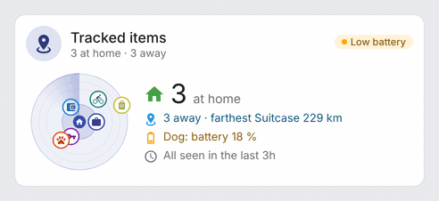 | 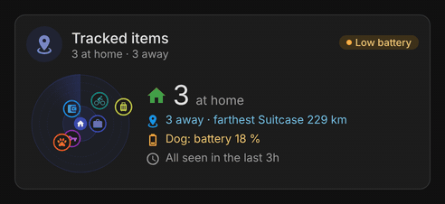 |

| Light | Dark |
|---|---|
| 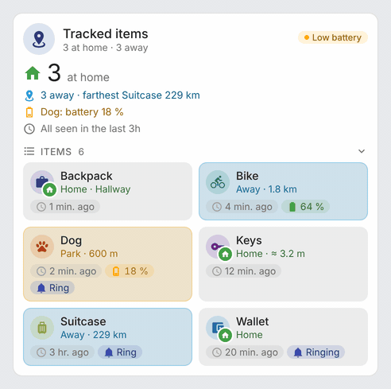 | 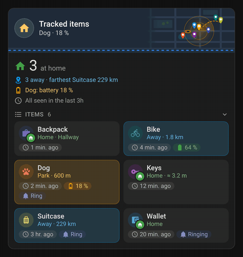 |

### Full card

Six items: keys, a backpack in the hallway, a wallet at home; a bike, the dog in the park (battery low) and a suitcase far away:

| Light | Dark |
|---|---|
|  | 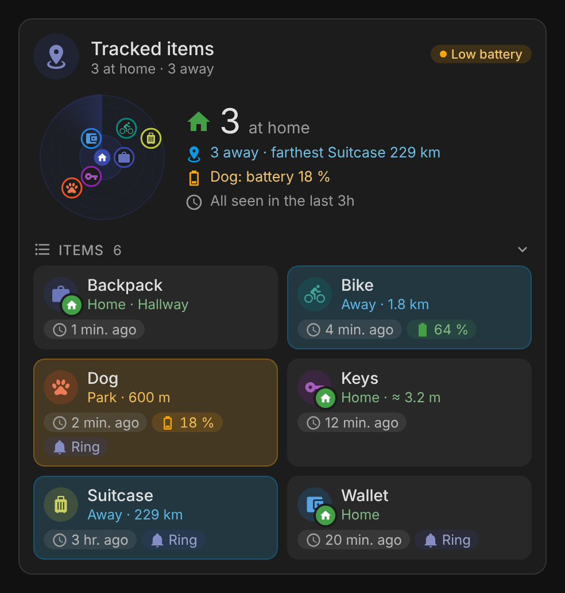 |

Every item back home (the header in green):

| Light | Dark |
|---|---|
| 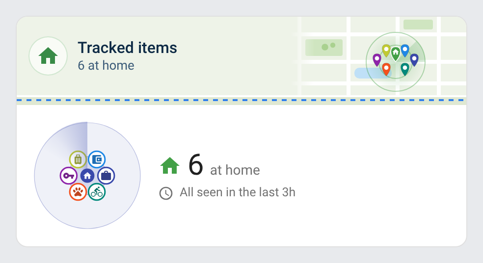 | 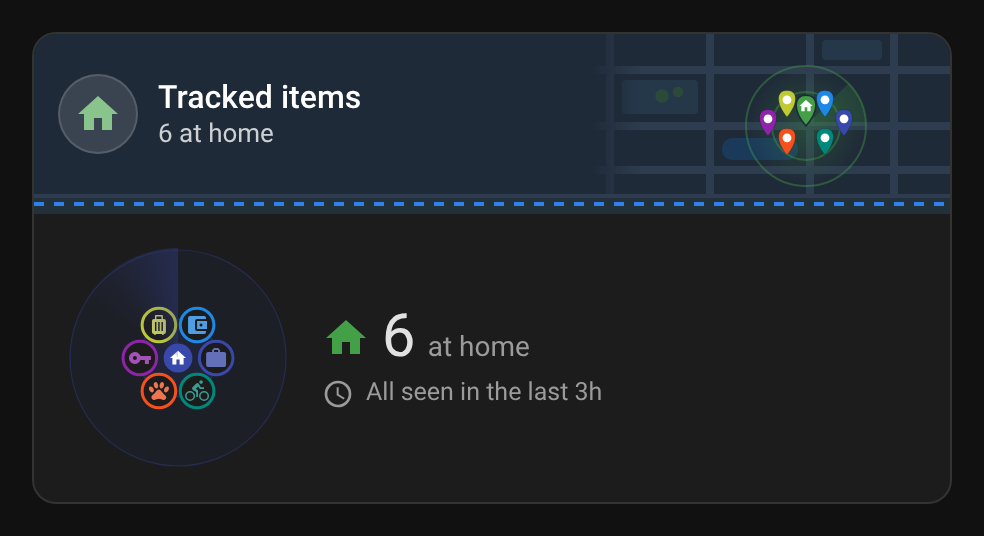 |

The suitcase not seen for two days (radar hidden):

| Light | Dark |
|---|---|
| 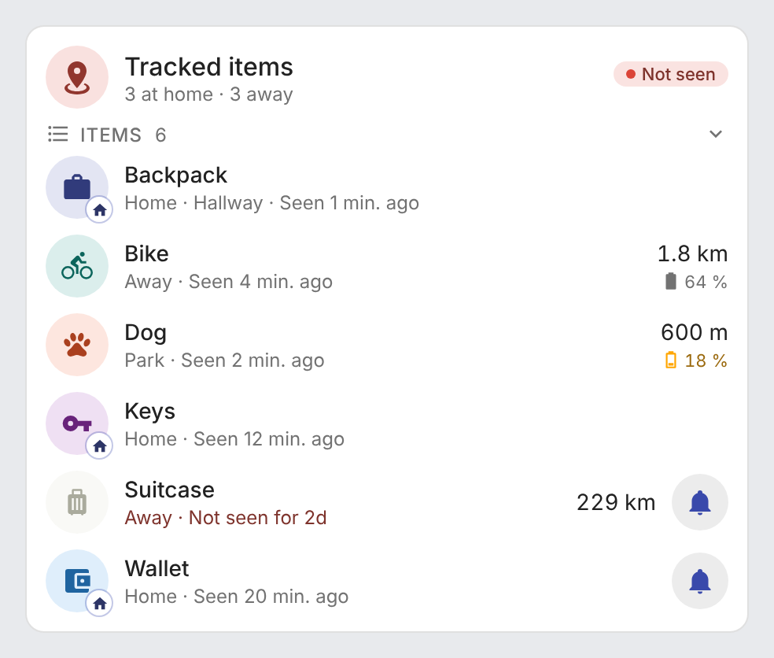 | 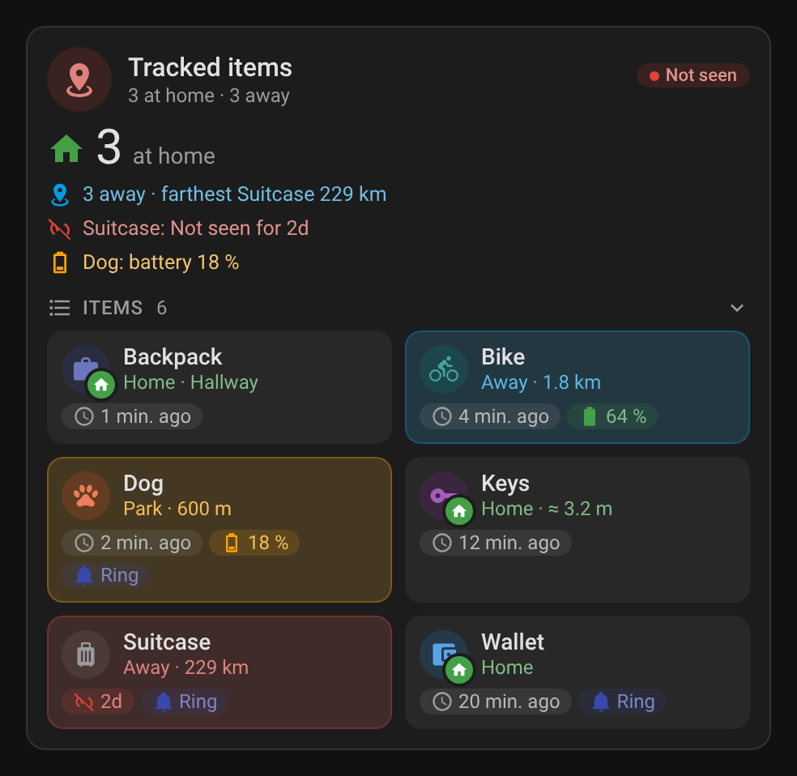 |

### Mini card

| Light | Dark |
|---|---|
|  | 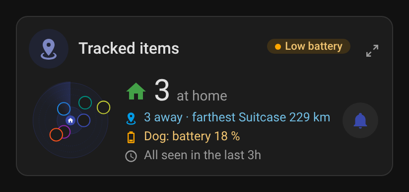 |
|  | 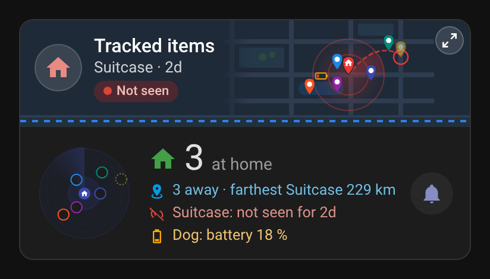 |

The detail button (top right) shows the full card's content:

| Light | Dark |
|---|---|
| 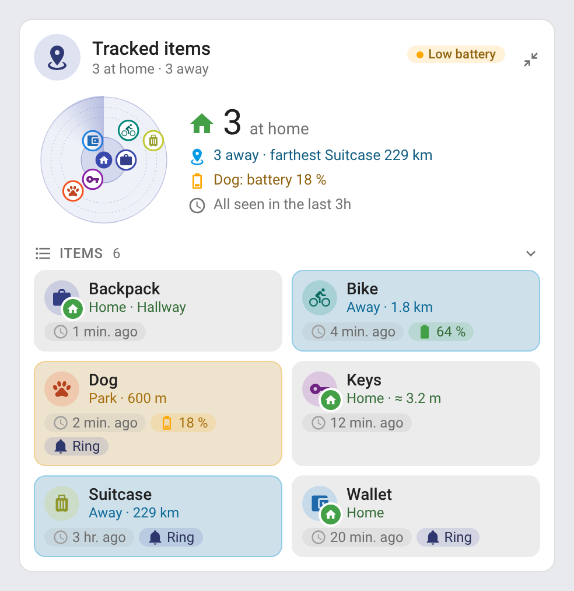 | 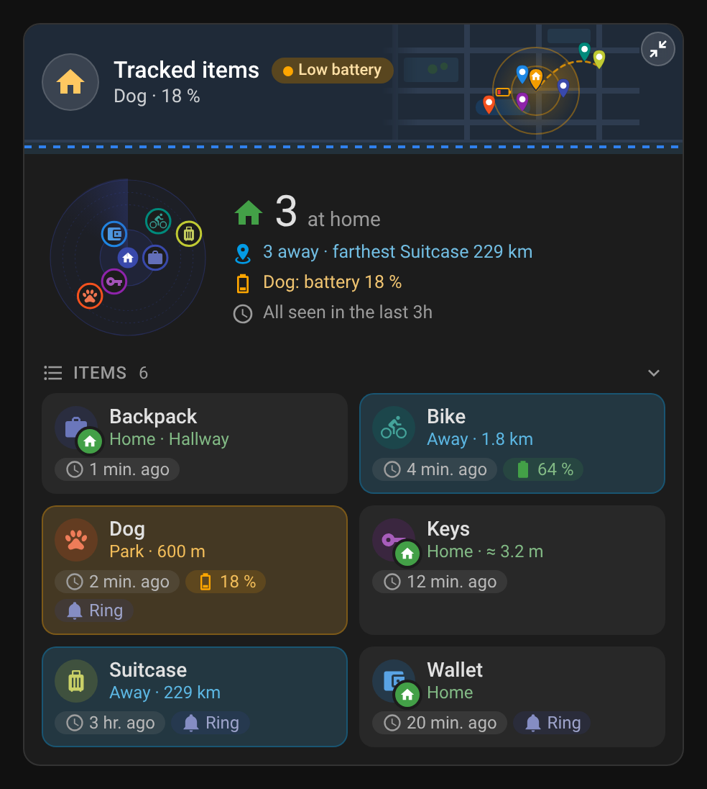 |

### Narrow cards

The full card at 6 columns of a phone's Sections view (the radar above its lines, one tile per row) and the mini card at its minimum width:

| Light | Dark |
|---|---|
| 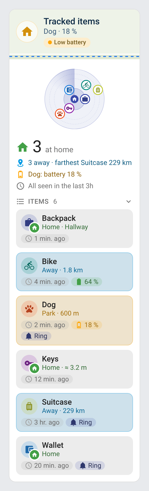 | 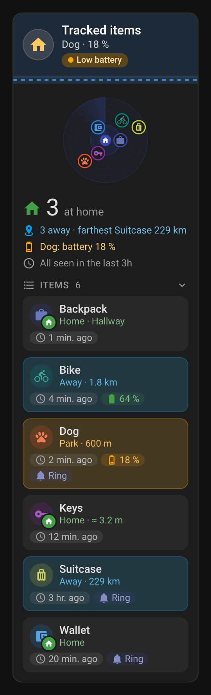 |
| 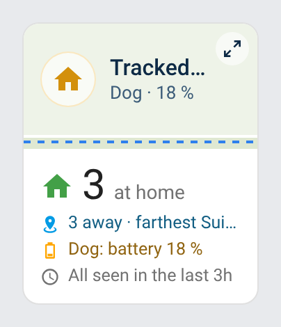 | 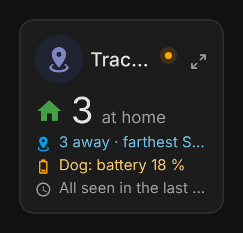 |

## How it works

- **Items** are the `device_tracker` entities of the tag, collar and GPS integrations, or those of `trackers`; their name is their device's.
- **Place**: `home`, a zone's name, or away (`not_home`); an item with a position within the home zone counts as home. Bermuda's **area** sensor of the same device adds the room.
- **Distance and direction** are computed from the item's `latitude` / `longitude` and those of `zone.home`; the radar's scale is logarithmic, so near and far items both fit.
- **Last seen**: a last-seen sensor of the device, else the tracker's `last_seen` / `last_timestamp` attribute, else its last update.
- **Not seen**: not seen for `lost_after` hours, or marked as lost by its integration (an `is_lost` attribute or a *lost* binary sensor of the device).
- **Estimated distance** (Private BLE Device, iBeacon): the device's estimated distance sensor, shown next to the place when there is no position.
- **Battery**: a battery sensor (or low-battery binary sensor) of the device, else a `battery_level` attribute.
- **Ring**: the device's button that plays a sound (play sound, ring, beep, buzz), else one that locates it (locate, find, alarm, identify), never a stop button (`button.press`); else the device's buzzer switch, as on Tractive collars (`switch.turn_on`).

## Development

```bash
npm install
npm run build        # bundles src/tracker-card.js into dist/tracker-card.js (and its translation files)
npm run check        # builds and checks the card (run in CI)
npm test             # unit tests
npm run screenshots  # renders the cards (and one GIF per animated state, needs ffmpeg) with mock data into screenshots/
```

`dist/` is not committed: `npm run build` creates it locally, CI builds it on every push, and the release workflow attaches the built files to the release, which is where the Marketplace installs it from. The captures are rendered on a fixed clock with mock data (scripts/mock-states.mjs) and rewritten only when their pixels change, exactly; on a pull request, the **Screenshots** workflow commits them to the pull request's branch.

### Releasing

1. Bump `version` in `package.json` (and `package-lock.json`, with `npm install`)
2. Add a `## <version>` section at the top of [CHANGELOG.md](https://github.com/juju35/ha-tracker-card/blob/main/CHANGELOG.md)
3. Push to `main`: the **Release** workflow builds the card, creates the tag and the GitHub release with the changelog section as notes, and attaches `tracker-card.js` and its translation files

## Translations

The cards auto-detect the language from your Home Assistant settings. Currently supported:

| Language | Code |
|---|---|
| English | `en` |
| Français | `fr` |
| Deutsch | `de` |
| Español | `es` |
| Српски | `sr` |
| Srpski (latinica) | `sr-Latn` |
| Italiano | `it` |
| Nederlands | `nl` |
| Português (European; also used for `pt-BR`) | `pt` |
| Polski | `pl` |
| Română | `ro` |
| Dansk | `da` |
| Svenska | `sv` |
| Български | `bg` |
| Русский | `ru` |
| Українська | `uk` |
| Magyar | `hu` |
| Slovenčina | `sk` |
| Čeština | `cs` |
| Slovenščina | `sl` |
| Latviešu | `lv` |
| Ελληνικά | `el` |

English is in the card's file; every other language is in its own small file (`tracker-card.i18n.<lang>.js`), loaded only when needed. Contributions for additional languages are welcome!

## Credits

Tile, Google Find My Device, Apple Find My, AirTag, iCloud, SmartThings, Galaxy SmartTag, Tractive, Fressnapf, PAJ GPS and Traccar are trademarks of their respective owners. This project is not affiliated with any of them. Icons from [Material Design Icons](https://pictogrammers.com/library/mdi/).

## License

[MIT](https://github.com/juju35/ha-tracker-card/blob/main/LICENSE)

## Support

If you find this project useful, you can support its development:

<a href="https://buymeacoffee.com/julienstep9"></a>
